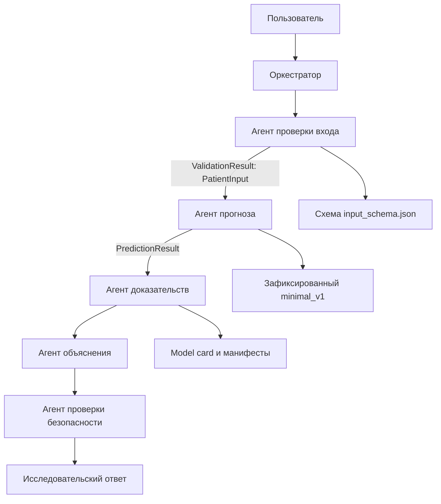

# Ассайнмент 2: архитектура системы

**Тема:** многоагентная ИИ-система для интерпретируемой исследовательской оценки пятилетней вероятности смерти от сердечно-сосудистых причин. Основа — уже зафиксированная модель `minimal_v1`; агентная система не обучает её заново.

## Схема

Сплошной путь показывает целевую архитектуру. **В прототипе реализованы только оркестратор, проверка входа и прогноз.** Передача типизированных данных между двумя специализированными агентами выполняется сейчас. Агент доказательств, объяснения и проверки безопасности запланированы на Ассайнмент 4; стрелки после прогноза пока не выполняются. Функция `build_prototype_graph()` отдельно создаёт конфигурацию Deep Agents для двух реализованных ролей. Основная CLI-демонстрация работает без LLM и использует детерминированные Python-инструменты.

## Спецификация ролей

| Агент | Статус | Роль | Вход | Выход | Инструменты | Критерий завершения |
|---|---|---|---|---|---|---|
| Оркестратор | Реализован | Вызывает роли по порядку, хранит состояние; не выполняет предметных расчётов | Запрос и поля | `PrototypeState` | Нет | Получен результат или ошибка |
| Проверка входа | Реализован | Проверяет семь полей по release-схеме, не подставляет отсутствующие значения | `dict` | `ValidationResult` с `PatientInput` или ошибками | `load_input_schema`, `validate_patient_input` | Все поля подтверждены или дан отказ |
| Прогноз | Реализован | Проверяет артефакты и вызывает зафиксированную модель | `PatientInput` | `PredictionResult` | `predict_cvd_mortality_risk` | Получена конечная вероятность |
| Доказательства | Планируется | Читает подтверждённые метрики, происхождение модели и ограничения | ID модели, вопрос | `EvidenceBundle` | Model card, манифесты | Факты имеют источники |
| Объяснение | Планируется | Формулирует понятную интерпретацию без причинных утверждений | Вход, прогноз, доказательства | `ExplanationResult` | Нет | Готов исследовательский текст |
| Проверка безопасности | Планируется | Проверяет исход, численный результат и запрет медицинских рекомендаций | Черновик и проверенные факты | `SafetyReview` | Правила безопасности | Ответ принят или отклонён |

У каждой роли не более пяти запланированных предметных инструментов. Deep Agents может добавлять собственные служебные инструменты; их фактический набор нужно проверить при завершении системы.

### План распределения вызовов

В типовом полном сценарии каждой из шести ролей предполагается один предметный вызов. Проверка входа, прогноз, получение доказательств и проверка безопасности дополнительно вызывают по одному или два инструмента; оркестратор только передаёт задачу. Такой план не отдаёт одному агенту весь процесс. Это **проектная оценка**, а не измеренные проценты: логирование всех вызовов и проверка предела 40% входят в Ассайнмент 4.

## Почему несколько агентов

Ошибки на этапах различаются: проверка входа предотвращает вымышленные измерения, прогноз исключает расчёт риска языковой моделью, доказательства предотвращают выдуманные метрики, объяснение отвечает за форму ответа, а проверка безопасности — за ограничения медицинского контекста. Оркестратор не смешивает эти обязанности. В прототипе видно первое разделение: агент прогноза не получает сырой запрос, только прошедший проверку `PatientInput`.

## Данные и состояние

Два типа источников уже подключены: файл `input_schema.json` и выполнение кода с сериализованной моделью `minimal_v1`. Обмен между ролями задают модели Pydantic. Состояние текущей задачи — явный объект `PrototypeState` в памяти процесса. Постоянное хранение, логи и измерение доли вызовов по ролям относятся к Ассайнменту 4. Пока нельзя утверждать, что ограничение 40% подтверждено логами: такой замер ещё не реализован.

Модель выдаёт вероятность **пятилетней сердечно-сосудистой смертности**, а не диагноз. Исследовательские ограничения и отсутствие валидации для Казахстана сохраняются.

## План следующего этапа: диалог с LLM

**Статус: планируется, сейчас не реализовано.** Для Ассайнмента 2 демонстрируется существующий CLI: проверка семи признаков и прогноз `minimal_v1`.

В следующем этапе пользователь сможет начать с вопроса, без обязательного расчёта, либо запросить оценку и затем обсудить её результат.

1. **Определение намерения.** Оркестратор будет различать запрос на расчёт, вопрос о модели или ССЗ, вопрос о предыдущем результате и запрос вне области системы. Он будет только распределять задачи; предметные ответы будут формировать специалисты.
2. **Вопрос до расчёта.** Агент доказательств будет получать факты из model card и подготовленных медицинских источников. Агент объяснения будет формировать ответ по этим фактам; прохождение анкеты для такого вопроса не потребуется.
3. **Расчёт по запросу.** Система будет запрашивать недостающие признаки и подтверждать введённые значения. Агент проверки будет валидировать семь полей, агент прогноза — вызывать существующий `minimal_v1`. LLM не будет вычислять вероятность или подставлять отсутствующие данные.
4. **Обсуждение результата.** В состоянии сессии будут храниться подтверждённые признаки, проверенный прогноз и история диалога. Агент объяснения сможет отвечать на последующие вопросы с учётом результата. При изменении признаков прежний прогноз нужно будет сбрасывать или пересчитывать.
5. **Подключение LLM.** Планируется API-подключение языковой модели для маршрутизации и формирования текста. API-ключ будет передаваться через окружение. Математическая модель риска останется отдельным инструментом.
6. **Проверка безопасности.** Отдельный агент будет проверять соответствие ответа источникам, исходу модели и численному результату, а также отсутствие диагноза и назначения лечения. Общие медицинские вопросы потребуют подготовленных источников; одной model card для них недостаточно.
7. **Проверки следующего этапа.** Добавить сценарии: вопрос без расчёта, расчёт с полными данными, запрос недостающих полей, вопрос после прогноза, смена признаков, запрос вне области и сбой LLM API. Добавить лимиты, обработку ошибок, логирование и измерение распределения нагрузки.

Примеры будущего диалога:

- До расчёта: «На каких данных обучена модель?» или «Что означает сердечно-сосудистый риск?».
- Запрос расчёта: «Хочу оценить риск» → сбор и проверка семи признаков → прогноз.
- После расчёта: «Что означает полученный процент?» или «Какие ограничения есть у результата?».

Сейчас диалоговый интерфейс и выполнение LLM-графа из CLI отсутствуют. Подготовленная конфигурация Deep Agents сама по себе не подтверждает работающий чат.
