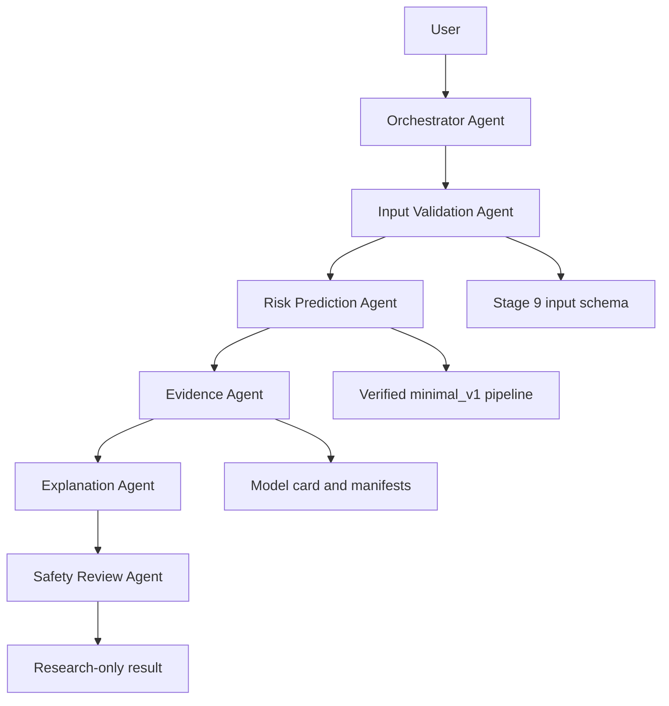

# Architecture

| Agent | Role | Input | Output | Domain tools | Completion criterion |
|---|---|---|---|---|---|
| `orchestrator_agent` | Coordinates bounded stages | Request, structured state | Status | None | Stage terminal |
| `input_validation_agent` | Rejects incomplete or out-of-contract input | Seven-field mapping | `ValidationResult` | `validate_patient_input` | Complete valid input or errors |
| `risk_prediction_agent` | Runs locked model | `PatientInput` | `PredictionResult` | `predict_cvd_mortality_risk` | Verified, calibrated probability |
| `evidence_agent` | Reads repository evidence | Model ID | `EvidenceBundle` | `get_model_evidence` | Source-grounded facts |
| `explanation_agent` | Renders research explanation | Patient, prediction, evidence | `ExplanationResult` | None | Short correct interpretation |
| `safety_review_agent` | Checks output constraints | Draft and verified facts | `SafetyReview` | `check_research_only_constraints` | Pass or bounded failure |

The normal CLI assessment uses six separate typed Python components. The Deep Agents graph in `deep.py` defines the same six named roles with `create_deep_agent`, five specialized subagents, and one coordinator. `assess --agent-mode` optionally runs that graph after deterministic assessment, requires all five task delegations, and returns the deterministic safety-reviewed response. The graph has **not** been validated against a real LLM provider in this environment. Deep Agents also injects its own filesystem and task tools, so the explicit 0–1 counts above describe **domain tools**, not every framework-provided tool. This is a remaining gap against a literal five-tools-total limit.

## Why six roles

Validation prevents invented inputs. Prediction confines arithmetic to the locked ML pipeline. Evidence prevents model-history hallucinations. Explanation renders technical results. Safety catches unsupported medical statements. Orchestration coordinates without doing domain work. Their failure modes differ, and typed boundaries make each stage auditable.

## Sources and state

Two source types are used: code execution against the SHA-verified joblib ML pipeline, and file-based evidence from the model card and manifests. Pydantic models carry stage results; `CVDWorkflowState` records transitions. Logs contain event metadata only. Sanitized state snapshots omit request text, health fields, prediction, and answer. Scenario runs carry a synthetic marker.

At most 12 workflow stage entries and one explanation revision are allowed. `TOTAL_RUN_TIMEOUT_SECONDS=60` is checked between stages. Blocking model and file calls currently lack a hard per-tool interruption, so the 20-second tool target is not fully enforced. A thrown error stops the run; there is no fabricated fallback probability.

Agent load counts one event for each Python agent call plus each explicit domain tool call. The standard complete run records ten calls; maximum share is 20%.
