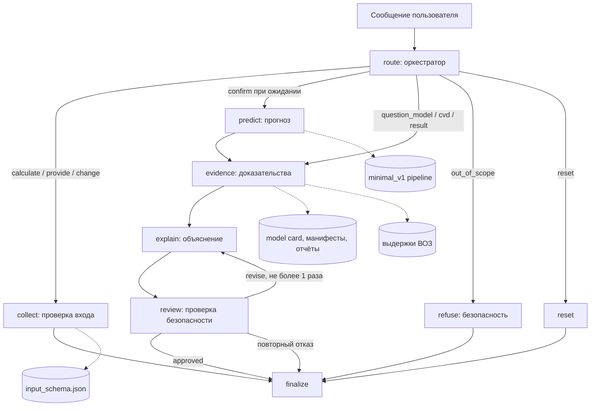

# Архитектура многоагентной системы (Ассайнмент 4)

**Тема:** многоагентная ИИ-система для интерпретируемой исследовательской оценки пятилетней вероятности смерти от сердечно-сосудистых причин на основе зафиксированной модели `minimal_v1`.

Ограничения:
- агентный слой не переобучает и не изменяет модель;
- вероятность вычисляет только модель;
- система не ставит диагнозов и не назначает лечение;
- модель не валидирована для Казахстана.

## 1. Схема одного хода диалога

Как устроен граф:
- Граф реализован в LangGraph `StateGraph` ([graph.py](src/cvd_agents/graph.py)).
- Порядок агентов задают рёбра графа, а не LLM. Поэтому прогноз невозможен без проверки и подтверждения входа, а ответ невозможен без проверки безопасности.
- Каждый узел вызывает ровно одного агента.

## 2. Роли

| Агент | LLM | Вход | Выход | Инструменты (фактические) | Критерий завершения |
|---|---|---|---|---|---|
| `orchestrator_agent` | Классификация намерения | Сообщение, сведения о сессии (без значений признаков), 4 последние реплики | `RoutingDecision` | **нет** | Выбрано одно из 10 намерений |
| `input_validation_agent` | Извлечение явно названных значений | Сообщение, известные поля | `InputOutcome` | `validate_partial_features`, `list_missing_fields`, `validate_complete_input` | Все 7 полей проверены и выведены на подтверждение, либо запрошены недостающие или исправленные |
| `risk_prediction_agent` | **Нет** | Подтверждённые признаки | `PredictionResult` | `verify_locked_release`, `predict_cvd_mortality_risk` | Получена вероятность от модели или явная ошибка |
| `evidence_agent` | Выбор инструментов поиска (`create_agent`) | Вопрос и его тип | `EvidenceBundle` (факты с путём и локатором) | `get_model_card_fact`, `search_model_documents`, `search_medical_sources` | LLM завершила поиск (≤ 3 вызова по промпту, recursion limit 8) |
| `explanation_agent` | Текст ответа | `EvidenceBundle`, результат, замечания безопасности | `ExplanationDraft` (текст и ID фактов) | **нет** | Черновик ссылается на факты; число подставляется кодом |
| `safety_review_agent` | Смысловая проверка | Черновик, факты, результат | `SafetyReview` | `check_draft_rules` | Черновик одобрен, либо после 1 доработки заменён безопасным шаблоном |

Набор инструментов проверяется тестом `test_framework_adds_no_hidden_tools_or_subagents`. Тест разбирает скомпилированный граф `create_agent` и убеждается, что фреймворк не добавил инструментов (в отличие от `deepagents` 0.7.21, где у каждого агента было 9).

Схема структурированного вывода (`with_structured_output`) задаёт формат ответа LLM и не является исполняемым инструментом.

Зачем разделять роли (по типам ошибок):

| Агент | От какой ошибки защищает |
|---|---|
| Проверка входа | Вымышленные значения: сверка цитат с текстом пользователя и схема release |
| Прогноз | Вычисление риска языковой моделью |
| Доказательства | Выдуманные факты: факты берутся только из вывода инструментов |
| Объяснение | Отвечает только за форму ответа |
| Проверка безопасности | Независимая проверка чужого текста: генератор и проверяющий разделены |
| Оркестратор | Не имеет инструментов и не формирует предметного содержания |

## 3. Контракты и состояние

Все сообщения — Pydantic-модели ([contracts.py](src/cvd_agents/contracts.py)).

`SessionState` — явное состояние сессии:
- фаза: `idle`, `collecting`, `awaiting_confirmation` или `result_ready`;
- признаки с номером реплики и цитатой-источником;
- счётчики ошибочных попыток;
- прогноз и хеш признаков, по которым он вычислен;
- последние реплики.

Если хеш текущих признаков не совпадает с хешем прогноза, прогноз считается устаревшим. В ответе он не показывается, пока пользователь не подтвердит новые значения.

## 4. Источники данных

1. Release-схема `artifacts/minimal_v1_research_release/input_schema.json`.
2. Сериализованный pipeline `minimal_v1` и проверка Stage 9 (SHA-256, provenance, smoke-инференс).
3. Документы модели из реестра [knowledge/sources.json](knowledge/sources.json): model card (Markdown и JSON), два манифеста, отчёты Stage 6 и Stage 8.
4. [knowledge/medical/who_cvd_fact_sheet.json](knowledge/medical/who_cvd_fact_sheet.json): 14 дословных выдержек из справки ВОЗ (опубликована 31.07.2025, обращение 06.11.2026). Перечни препаратов и операций исключены намеренно. Статус: ждёт проверки автором.
5. LLM API (OpenAI, модель задаётся в `AGENT_MODEL`).

Поиск локальный и детерминированный: TF-IDF по ключевым словам с небольшим словарём русско-английских синонимов.

## 5. Лимиты, ошибки, повторы

Значения задаются в [config.py](src/cvd_agents/config.py).

| Механизм | Значение |
|---|---|
| Шагов агентов за ход | 10 (`StepLimitError` → статус `limit_exceeded`) |
| Recursion limit агента доказательств | 8 |
| Recursion limit графа хода | 25 |
| Тайм-аут одного LLM-вызова / хода | 30 с / 90 с |
| Повторы LLM | 3 попытки при timeout, 429, 5xx, обрыве соединения; экспоненциальная задержка. Повторы SDK отключены (`max_retries=0`), поэтому каждая попытка видна в журнале |
| Доработка после проверки безопасности | 1, затем безопасный шаблон |
| Ошибочные попытки по одному полю | 3, затем предложение ввести значения формой (`assess`) |
| Отказ проверки release или модели | Статус `error`, вероятность не выдаётся |

## 6. Журнал и нагрузка

- `runs/<session>/events.jsonl`: одно событие на каждый ход, вызов агента, вызов LLM, вызов инструмента и повтор.
- События LLM и инструментов пишет callback LangChain ([telemetry.py](src/cvd_agents/telemetry.py)), поэтому вызовы внутри `create_agent` тоже попадают в журнал.
- Значения признаков, текст пользователя и ключи в журнал не пишутся.
- `load_report.json`: доля вызовов LLM и инструментов по агентам.

Живой замер типового сценария: 32 вызова, максимальная доля 34.4% у `evidence_agent`. Подробности в [VERIFICATION.md](VERIFICATION.md).
