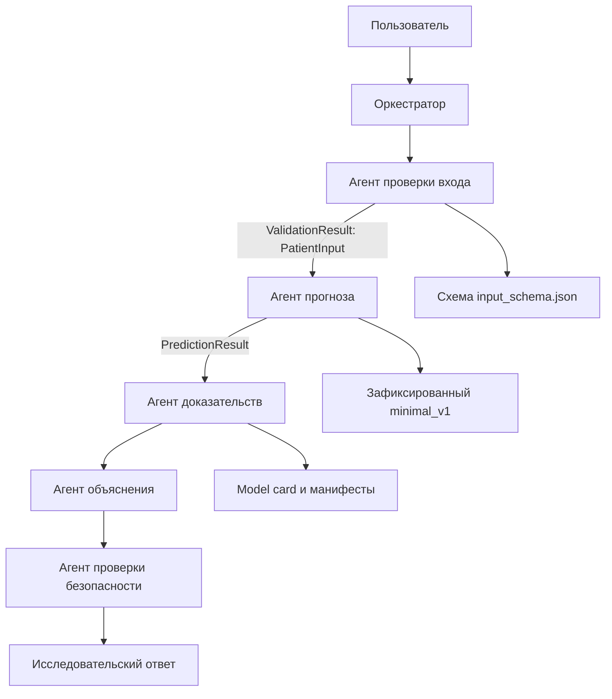

# Устройство проекта и последовательность выполнения

## 1. Основная модель `minimal_v1`

Описание модели находится в [reports/minimal_v1_model_card.md](../reports/minimal_v1_model_card.md).

`minimal_v1` — существующая исследовательская модель для оценки вероятности смерти от сердечно-сосудистых причин в течение пяти лет. Её обучение выполнено на NHIS 1997–2009. После фиксации модели проведены temporal-проверка на NHIS 2010–2014 и внешняя проверка на NHANES 1999–2014. Таким образом, оба источника использованы в исследовании, но выполняют разные задачи: NHIS development — обучение, NHANES — внешняя проверка зафиксированной модели.

| Данные | Участники (N) | Сердечно-сосудистые смерти за пять лет | Роль для `minimal_v1` |
|---|---:|---:|---|
| NHIS 1997–2009 | 178 120 | 2 036 | Обучение, development cross-validation и калибровка |
| NHIS 2010–2014 | 82 860 | 834 | Temporal-проверка на более поздних данных |
| NHANES 1999–2014 | 20 911 | 255 | Внешняя проверка на другом источнике данных |

Это размеры итоговых аналитических когорт `minimal_v1`, а не количество всех записей в исходных опросах. Числа участников и смертей приведены без survey-взвешивания; номинальный размер N не равен эффективному размеру выборки при сложном дизайне опроса. Источник: [machine-readable model card](../artifacts/minimal_v1_model_card/status.json), разделы `development` и `validation`.

Модель использует семь признаков:

1. `age` — возраст;
2. `sex` — пол;
3. `bmi` — индекс массы тела;
4. `smoking_status` — статус курения;
5. `hypertension_dx` — наличие ранее диагностированной гипертонии;
6. `diabetes_dx` — наличие ранее диагностированного диабета;
7. `general_health` — самооценка общего здоровья.

Результат модели — непрерывная вероятность пятилетней сердечно-сосудистой смертности. Он не является диагнозом, вероятностью инфаркта или инсульта по отдельности либо рекомендацией лечения. Модель не валидирована для Казахстана. Temporal и external проверки имеют статус underpowered/exploratory.

Агентный слой использует эту модель без повторного обучения или изменения её компонентов.

## 2. Где хранится обученная модель

Обученный объект сохранён в [full_development_pipeline.joblib](../artifacts/minimal_v1/full_development_pipeline.joblib). Это бинарный файл сериализации, содержащий fitted preprocessing, estimator и calibrator.

Класс объекта описан в [src/cvd_risk/modeling/baselines.py](../src/cvd_risk/modeling/baselines.py), в `FittedBaselineModel`. Его поля:

- `preprocessor` — обученное преобразование входных признаков;
- `estimator` — логистическая регрессия;
- `calibrator` — обученный sigmoid/Platt-калибратор;
- `probability_clip` — граница ограничения исходной вероятности перед преобразованием в logit.

Метод `predict_proba(frame, calibrated=True)` выполняет следующую последовательность:

```text
DataFrame с семью признаками
    → preprocessor.transform(features)
    → estimator.predict_proba(matrix)[:, 1]
    → ограничение исходной вероятности и преобразование в logit
    → calibrator.predict_proba(linear_predictor)[:, 1]
    → калиброванная вероятность
```

Отдельный файл `calibrator.joblib` не применяется повторно: калибратор уже находится внутри полного pipeline. Дополнительное ограничение конечной вероятности этот метод не выполняет.

## 3. Связь корневого проекта и `multi_agent`

В одном Git-репозитории находятся исследовательский Python-проект и подпроект агентного прототипа:

```text
SSR/
├── src/cvd_risk/             # существующий исследовательский код
├── artifacts/minimal_v1/    # зафиксированная обученная модель
├── reports/                 # исследовательские отчёты
├── pyproject.toml
├── uv.lock                  # зафиксированное исследовательское окружение
└── multi_agent/
    ├── src/cvd_agents/       # код прототипа
    ├── pyproject.toml
    └── uv.lock              # отдельное окружение с Deep Agents
```

Подпроект подключает корневой пакет через [multi_agent/pyproject.toml](pyproject.toml):

```toml
[tool.uv.sources]
cvd-risk-model = { path = "..", editable = true }
```

Поэтому код `cvd_agents` может импортировать функции из `cvd_risk` и загружать существующие артефакты модели. В основной CLI-демонстрации всё выполняется в одном процессе Python; сетевое взаимодействие между этими пакетами не требуется.

Отдельное окружение позволяет установить Deep Agents без изменения корневого `uv.lock`, который привязан к исследовательскому release manifest. Версии библиотек для загрузки модели в подпроекте соответствуют runtime contract: Python 3.12, joblib 1.5.3, NumPy 2.5.1, pandas 2.3.3 и scikit-learn 1.9.0.

## 4. Целевая архитектура и текущий прототип

Схема и спецификация ролей находятся в [ARCHITECTURE.md](ARCHITECTURE.md).

## Схема



Сплошной путь показывает целевую архитектуру. **В прототипе реализованы только оркестратор, проверка входа и прогноз.** Передача типизированных данных между двумя специализированными агентами выполняется сейчас. Агент доказательств, объяснения и проверки безопасности запланированы на Ассайнмент 4; стрелки после прогноза пока не выполняются. Функция `build_prototype_graph()` отдельно создаёт конфигурацию Deep Agents для двух реализованных ролей. Основная CLI-демонстрация работает без LLM и использует детерминированные Python-инструменты.

## Спецификация ролей

| Агент | Статус | Роль | Вход | Выход | Инструменты |
|---|---|---|---|---|---|
| Оркестратор | Реализован | Вызывает роли по порядку, хранит состояние; не выполняет предметных расчётов | Запрос и поля | `PrototypeState` | Нет |
| Проверка входа | Реализован | Проверяет семь полей по release-схеме, не подставляет отсутствующие значения | `dict` | `ValidationResult` с `PatientInput` или ошибками | `load_input_schema`, `validate_patient_input` |
| Прогноз | Реализован | Проверяет артефакты и вызывает зафиксированную модель | `PatientInput` | `PredictionResult` | `predict_cvd_mortality_risk` |
| Доказательства | Планируется | Читает подтверждённые метрики, происхождение модели и ограничения | ID модели, вопрос | `EvidenceBundle` | Model card, манифесты |
| Объяснение | Планируется | Формулирует понятную интерпретацию без причинных утверждений | Вход, прогноз, доказательства | `ExplanationResult` | Нет |
| Проверка безопасности | Планируется | Проверяет исход, численный результат и запрет медицинских рекомендаций | Черновик и проверенные факты | `SafetyReview` | Правила безопасности |

У каждой роли не более пяти запланированных предметных инструментов. Deep Agents может добавлять собственные служебные инструменты; их фактический набор нужно проверить при завершении системы.

### План распределения вызовов

В типовом полном сценарии каждой из шести ролей предполагается один предметный вызов. Проверка входа, прогноз, получение доказательств и проверка безопасности дополнительно вызывают по одному или два инструмента; оркестратор только передаёт задачу. Такой план не отдаёт одному агенту весь процесс. Это **проектная оценка**, а не измеренные проценты: логирование всех вызовов и проверка предела 40% входят в Ассайнмент 4.

## Почему несколько агентов

Ошибки на этапах различаются: проверка входа предотвращает вымышленные измерения, прогноз исключает расчёт риска языковой моделью, доказательства предотвращают выдуманные метрики, объяснение отвечает за форму ответа, а проверка безопасности — за ограничения медицинского контекста. Оркестратор не смешивает эти обязанности. В прототипе видно первое разделение: агент прогноза не получает сырой запрос, только прошедший проверку `PatientInput`.


Целевая система содержит шесть ролей:

| Роль | Ответственность | Текущее состояние |
|---|---|---|
| Оркестратор | Задаёт порядок вызовов и хранит состояние задачи | Реализован как Python-компонент |
| Проверка входа | Проверяет полноту и допустимость данных | Реализована как Python-компонент |
| Прогноз | Вызывает зафиксированную ML-модель | Реализован как Python-компонент |
| Доказательства | Получает подтверждённые сведения из model card и манифестов | Описан в архитектуре |
| Объяснение | Формулирует интерпретацию результата | Описан в архитектуре |
| Проверка безопасности | Проверяет ограничения и корректность итогового ответа | Описан в архитектуре |

Роли разделены по причинам возможных ошибок. Проверка входа предотвращает использование неподтверждённых значений. Прогноз ограничивает численный расчёт существующей моделью. Получение доказательств должно предотвращать выдуманные метрики. Объяснение отвечает за текст результата, а проверка безопасности — за его допустимость. Оркестратор координирует эти действия.

В текущем CLI работает фиксированный Python-конвейер проверки входа и прогноза. Конфигурация Deep Agents подготовлена отдельно, но CLI её пока не запускает.

## 5. Точка входа: `cli.py`

Файл: [src/cvd_agents/cli.py](src/cvd_agents/cli.py).

Функция `main()` создаёт `ArgumentParser`, принимает семь аргументов командной строки и собирает из них словарь:

```python
state = OrchestratorAgent().assess(
    {
        "age": args.age,
        "sex": args.sex,
        "bmi": args.bmi,
        "smoking_status": args.smoking_status,
        "hypertension_dx": args.hypertension,
        "diabetes_dx": args.diabetes,
        "general_health": args.general_health,
    }
)
```

Этот вызов запускает прототип. После завершения `state.model_dump()` преобразует состояние в словарь, а `json.dumps()` выводит его как JSON. Успешное выполнение возвращает код выхода `0`; отклонённый ввод или ошибка — `1`.

## 6. Координация: `prototype.py`

Файл: [src/cvd_agents/prototype.py](src/cvd_agents/prototype.py).

В нём определены три класса:

- `InputValidationAgent.run(raw)` вызывает инструмент проверки входа;
- `RiskPredictionAgent.run(patient)` вызывает инструмент прогноза;
- `OrchestratorAgent.assess(raw)` связывает эти компоненты.

Ключевая последовательность внутри `assess()`:

```python
state.validation = self.input_agent.run(raw)

if not state.validation.valid or state.validation.normalized_input is None:
    state.status = "invalid_input"
    return state

state.prediction = self.prediction_agent.run(
    state.validation.normalized_input
)
state.status = "completed"
```

Первый компонент получает сырой словарь и возвращает `ValidationResult`. Оркестратор проверяет результат и передаёт содержащийся в нём `PatientInput` компоненту прогноза. Это конкретное место передачи структурированных данных между двумя ролями.

Если проверка входа не пройдена, вызов модели не выполняется. Исключение при обработке задачи переводит состояние в `error` и сохраняет сообщение об ошибке. Оркестратор не вычисляет вероятность и не реализует правила проверки полей.

## 7. Контракты и состояние: `contracts.py`

Файл: [src/cvd_agents/contracts.py](src/cvd_agents/contracts.py).

Модели Pydantic задают форматы данных:

| Контракт | Содержимое |
|---|---|
| `PatientInput` | Семь входных признаков с заданными типами; лишние поля запрещены |
| `ValidationResult` | `valid`, список `errors`, проверенный `normalized_input` |
| `PredictionResult` | ID модели, название исхода, вероятность, вероятность в процентах, `research_only` |
| `PrototypeState` | Статус задачи, результат проверки, прогноз и сообщение об ошибке |

`PatientInput` проверяет типы полей. Диапазоны чисел и допустимые категории дополнительно проверяются по release-схеме в `tools.py`.

`PrototypeState` существует в памяти процесса. В этой версии постоянное хранение состояния, JSONL-логи и измерение нагрузки не реализованы.

## 8. Проверка входа: `tools.py`

Файл: [src/cvd_agents/tools.py](src/cvd_agents/tools.py), функция `validate_patient_input()`.

Инструмент получает правила из [input_schema.json](../artifacts/minimal_v1_research_release/input_schema.json). Последовательность проверки:

1. Загрузить схему модели.
2. Найти отсутствующие обязательные и лишние поля.
3. Проверить типы через `PatientInput.model_validate(raw)`.
4. Проверить конечность чисел, диапазоны и категориальные значения.
5. Вернуть ошибки либо `ValidationResult(valid=True, normalized_input=patient)`.

Основные ограничения схемы:

- возраст — от 40 до 79;
- BMI — от 10 до 99.8;
- `sex` — `female` или `male`;
- `smoking_status` — `never`, `former` или `current`;
- `general_health` — `excellent`, `very_good`, `good`, `fair` или `poor`;
- `hypertension_dx` и `diabetes_dx` — логические значения.

Отсутствующие пользовательские значения не заменяются средними или вымышленными измерениями.

## 9. Вызов основной модели: `tools.py`

В том же файле функция `predict_cvd_mortality_risk(patient)` соединяет прототип с существующим ML-проектом.

| Действие | Назначение |
|---|---|
| `validate_stage9_research_release(root=REPO_ROOT)` | Проверить release, SHA артефактов, происхождение и runtime contract; выполнить существующую smoke-проверку |
| Получение `ordered_features` из схемы | Использовать точный порядок признаков модели |
| Создание `pd.DataFrame` | Подготовить одну строку в ожидаемом формате |
| `validate_minimal_v1_research_input(frame, schema)` | Проверить канонический контракт DataFrame |
| `joblib.load(MODEL_PATH)` | Загрузить проверенный обученный pipeline |
| `model.predict_proba(frame, calibrated=True)` | Получить конечную калиброванную вероятность |
| Создание `PredictionResult` | Вернуть структурированный результат |

Проверка Stage 9 реализована в [src/cvd_risk/modeling/stage9_research_release.py](../src/cvd_risk/modeling/stage9_research_release.py). Этот код импортируется из корневого исследовательского пакета.

Два типа источников уже используются в прототипе: файловая release-схема и выполнение кода с сериализованной ML-моделью.

## 10. Полный путь выполнения CLI

```text
Команда в терминале
    → cli.main(): чтение аргументов
    → OrchestratorAgent.assess(raw)
    → InputValidationAgent.run(raw)
    → validate_patient_input(raw)
    → ValidationResult с PatientInput
    → RiskPredictionAgent.run(patient)
    → predict_cvd_mortality_risk(patient)
    → проверка Stage 9 и загрузка pipeline
    → FittedBaselineModel.predict_proba(frame, calibrated=True)
    → PredictionResult
    → PrototypeState(status="completed")
    → JSON в терминале
```

При ошибочном входе путь заканчивается после `ValidationResult`: состояние получает `invalid_input`, а `prediction` остаётся `null`.

## 11. Демонстрационный запуск

Команды выполняются из папки `multi_agent/`:

```powershell
uv sync --locked --group dev
uv run --locked python -m cvd_agents.cli --age 58 --sex male --bmi 28.1 --smoking-status former --hypertension --no-diabetes --general-health good
```

Для этого синтетического примера проверенный запуск вернул:

```json
{
  "status": "completed",
  "prediction": {
    "model_id": "minimal_v1",
    "outcome": "five_year_cvd_mortality",
    "probability": 0.008374412441555734,
    "probability_percent": 0.8374412441555734,
    "research_only": true
  }
}
```

Здесь приведён фрагмент вывода: полный JSON также содержит `validation` и `error`. Вероятность в процентах составляет приблизительно 0.8374%.

Для проверки отказа при недопустимом возрасте:

```powershell
uv run --locked python -m cvd_agents.cli --age 39 --sex male --bmi 28.1 --smoking-status former --hypertension --no-diabetes --general-health good
```

Ожидаемые поля результата: `status: invalid_input`, `normalized_input: null`, `prediction: null`. Код выхода `1` означает отклонённый ввод.

## 12. Deep Agents: подготовленная конфигурация

Файл: [src/cvd_agents/deep_prototype.py](src/cvd_agents/deep_prototype.py).

Декоратор `@tool` оформляет функции проверки и прогноза как инструменты LangChain. Они принимают JSON и вызывают те же детерминированные функции из `tools.py`.

Функция `build_prototype_graph()` использует `create_deep_agent()` и задаёт:

- оркестратор с инструкцией координировать проверку и прогноз;
- `input_validation_agent` с инструментом `validate_input_tool`;
- `risk_prediction_agent` с инструментом `locked_prediction_tool`;
- модель из переменной окружения `AGENT_MODEL` либо заданную явно.

Эта функция создаёт граф, но не запускает его. В `cli.py` вызывается `OrchestratorAgent` из `prototype.py`; вызова `build_prototype_graph()` и выполнения LLM-графа там нет.

Текущая CLI-демонстрация подтверждает проверку данных, передачу типизированного объекта и инференс реальной модели. Делегирование между LLM-агентами через Deep Agents в этом пути пока не подключено и не проверено.

## 13. Проверки прототипа

Файл: [tests/test_prototype.py](tests/test_prototype.py).

```powershell
uv run --locked pytest -q
```

Четыре теста прототипа проверяют:

1. Проверка полного Python-конвейера с реальными артефактами `minimal_v1`.
2. Остановка до прогноза при возрасте вне допустимого диапазона.
3. Отказ при отсутствии BMI без подстановки значения.
4. Создание конфигурации Deep Agents с тестовой моделью без API-вызова.

Четвёртый тест проверяет только построение графа. Он не подтверждает выполнение LLM-делегирования.

## 14. Порядок изучения файлов

1. `reports/minimal_v1_model_card.md` — назначение модели, признаки, происхождение и ограничения.
2. `src/cvd_risk/modeling/baselines.py` — внутренний путь вычисления вероятности.
3. `multi_agent/ARCHITECTURE.md` — целевые роли и их связи.
4. `multi_agent/src/cvd_agents/cli.py` — начало запуска.
5. `multi_agent/src/cvd_agents/prototype.py` — порядок вызовов и передача данных.
6. `multi_agent/src/cvd_agents/contracts.py` — форматы сообщений и состояние.
7. `multi_agent/src/cvd_agents/tools.py` — проверка входа и связь с моделью.
8. `multi_agent/src/cvd_agents/deep_prototype.py` — подготовленная конфигурация LLM-агентов.
9. `multi_agent/tests/test_prototype.py` — границы выполненной проверки.

## План следующего этапа: диалог с LLM

**Статус: планируется, сейчас не реализовано.** Для Ассайнмента 2 демонстрируется существующий CLI: проверка семи признаков и прогноз `minimal_v1`.

В следующем этапе пользователь сможет начать с вопроса, без обязательного расчёта, либо запросить оценку и затем обсудить её результат.

1. **Определение намерения.** Оркестратор будет различать запрос на расчёт, вопрос о модели или ССЗ, вопрос о предыдущем результате и запрос вне области системы. Он будет только распределять задачи; предметные ответы будут формировать специалисты.
2. **Вопрос до расчёта.** Агент доказательств будет получать факты из model card и подготовленных медицинских источников. Агент объяснения будет формировать ответ по этим фактам; прохождение анкеты для такого вопроса не потребуется.
3. **Расчёт по запросу.** Система будет запрашивать недостающие признаки и подтверждать введённые значения. Агент проверки будет валидировать семь полей, агент прогноза — вызывать существующий `minimal_v1`. LLM не будет вычислять вероятность или подставлять отсутствующие данные.
4. **Обсуждение результата.** В состоянии сессии будут храниться подтверждённые признаки, проверенный прогноз и история диалога. Агент объяснения сможет отвечать на последующие вопросы с учётом результата. При изменении признаков прежний прогноз нужно будет сбрасывать или пересчитывать.
5. **Подключение LLM.** Планируется API-подключение языковой модели для маршрутизации и формирования текста. API-ключ будет передаваться через окружение. Математическая модель риска останется отдельным инструментом.
6. **Проверка безопасности.** Отдельный агент будет проверять соответствие ответа источникам, исходу модели и численному результату, а также отсутствие диагноза и назначения лечения. Общие медицинские вопросы потребуют подготовленных источников; одной model card для них недостаточно.
7. **Проверки следующего этапа.** Добавить сценарии: вопрос без расчёта, расчёт с полными данными, запрос недостающих полей, вопрос после прогноза, смена признаков, запрос вне области и сбой LLM API. Добавить лимиты, обработку ошибок, логирование и измерение распределения нагрузки.

Примеры будущего диалога:

- До расчёта: «На каких данных обучена модель?» или «Что означает сердечно-сосудистый риск?».
- Запрос расчёта: «Хочу оценить риск» → сбор и проверка семи признаков → прогноз.
- После расчёта: «Что означает полученный процент?» или «Какие ограничения есть у результата?».

Сейчас диалоговый интерфейс и выполнение LLM-графа из CLI отсутствуют. Подготовленная конфигурация Deep Agents сама по себе не подтверждает работающий чат.
