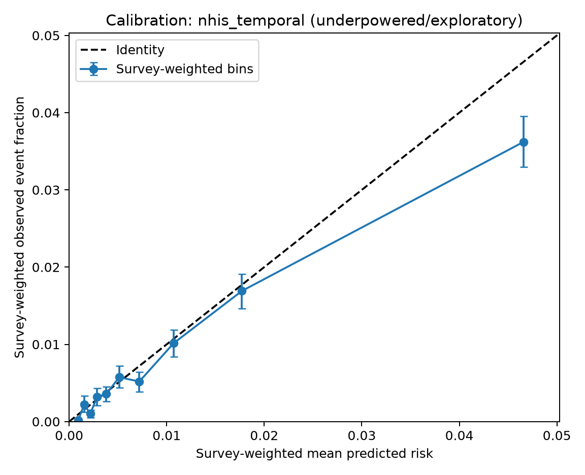
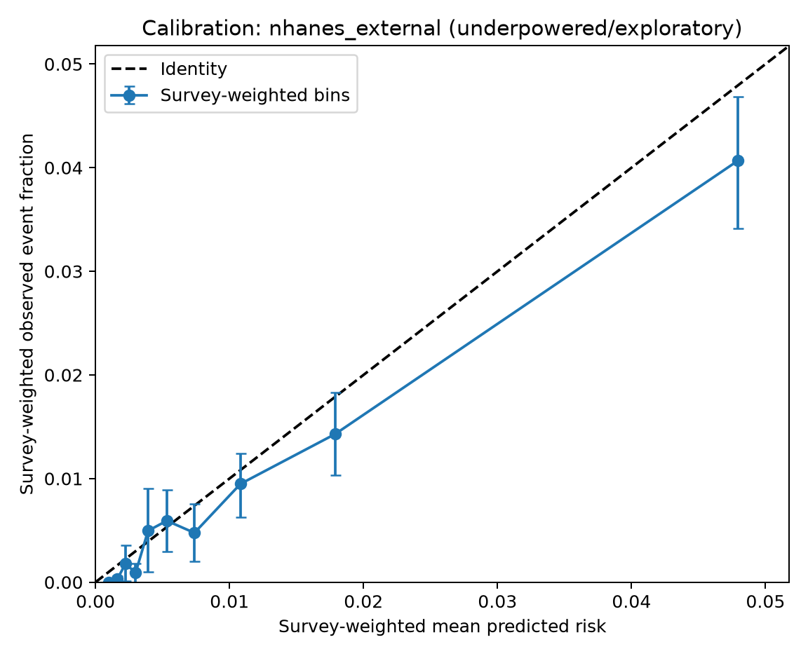

# Stage 6 one-time unseal validation: final aggregate report

## Mandatory interpretation and immutable analysis

All temporal and external validation results in this report are
**underpowered/exploratory**. Both pre-unseal precision gates failed, so no
claim of adequate validation precision is made. The model, preprocessing,
sigmoid calibrator, frozen individual predictions, and fixed secondary
screening cutoff `0.007469058716065273` were not changed, refit, or reselected.
The cutoff is not a diagnosis or a clinically endorsed high-risk boundary.

This report was assembled after the one-time run from already-created
aggregate CSV, JSON, and PNG outputs only. No individual outcome file,
participant-level joined data, frozen prediction Parquet, or raw bootstrap
replicate was loaded to prepare this report. The generated execution report
remains unchanged at
[`stage6_underpowered_exploratory_validation.md`](stage6_underpowered_exploratory_validation.md)
because its SHA is immutable in the execution manifest.

## Authorization and execution provenance

| Artifact | Status | SHA-256 | Hash mode |
|---|---|---|---|
| [`unseal_authorization.json`](../artifacts/audit/unseal_authorization.json) | `AUTHORIZED_ONE_TIME_UNSEAL` | `cfeb02bb670c8699c5d7c70c4884deedb448ea24a651e6e435bae7a33d9c00bc` | normalized text LF |
| [`unseal_access_receipt.json`](../artifacts/audit/unseal_access_receipt.json) | `ONE_TIME_UNSEAL_VALIDATION_COMPLETE` | `53d2abf194788bf4739b0f6ca54c6fd1b493a99d035a3a8a68957cf39d1d87a3` | normalized text LF |
| [`manifest.json`](../artifacts/stage6_validation/manifest.json) | `COMPLETE_UNDERPOWERED_EXPLORATORY` | `bdc0053ce6885c85fa9408a19e52e62fb0532a76dc53f1d2db49694d203e132a` | normalized text LF |

The receipt confirms that outcomes were unsealed once and that model,
calibrator, and cutoff changes were not authorized. The execution manifest
confirms `model_modified=false`, `calibrator_modified=false`, and
`cutoff_modified_or_reselected=false`.

## Locked lineage and frozen bindings

| Binding | Commit or SHA-256 |
|---|---|
| Locked source commit | `5cace77785c3e7e3398ead12efc101ae235034ec` |
| Original lock commit | `a75366b7ab29d7a29d18353dc18e2d29ef0b8218` |
| Original lock SHA | `983461d0eaf53592fc26b2615ad4f00a6e2768482d1adac6366f49526ea1f6a3` |
| Lock amendment commit | `907c8f5cb8062b5a0c83013c78935a6d547acf11` |
| Lock amendment SHA | `84a846207cf221dbe9839ede497503f708b4738f1900c943ffe66e146b0ab450` |
| Stage 6 label-free commit | `66041aa9880c36ec710137358d50f32b4f900d54` |
| Pre-registered unseal plan commit | `1c0e1aa36ab21184beb7d8be9455ee2eb2424b49` |
| Frozen pipeline SHA | `758d635310a43596655bd23a0ebcebc293a0f4bde4ab5d98f3852a84e023a010` |
| NHIS temporal prediction SHA | `010b5e45b162145ef77c714e499cb09ebef7007ee506c2cfe9946547721f2ab2` |
| NHANES external prediction SHA | `c8277dcc1ab1e1246d24790d253007b9d6dc6d143bd1269f1ac8604f97a301d0` |

The lock and metadata-only amendment are available at
[`external_validation_lock.json`](../artifacts/minimal_v1/external_validation_lock.json)
and
[`external_validation_lock_amendment_001.json`](../artifacts/minimal_v1/external_validation_lock_amendment_001.json).

## Pre-unseal precision gates

| Cohort | Nominal N | Required N after design effect | Gate effective N | Precision gate |
|---|---:|---:|---:|---|
| NHIS temporal | 82,860 | 99,862 | 34,089.26 | **FAIL** |
| NHANES external | 20,911 | 144,636 | 5,939.82 | **FAIL** |

These frozen pre-unseal results come from
[`stage6_precision_gate.csv`](tables/stage6_precision_gate.csv). The failures
are the reason every result below remains **underpowered/exploratory**, even
where an individual post-unseal CI-width diagnostic passes.

## Join integrity and outcome counts

| Cohort | Prediction N | Joined N | Events | Non-events | Prediction duplicate IDs | Outcome duplicate IDs | Unmatched prediction IDs | Unmatched outcome IDs | Missing outcomes | Status |
|---|---:|---:|---:|---:|---:|---:|---:|---:|---:|---|
| NHIS temporal | 82,860 | 82,860 | 834 | 82,026 | 0 | 0 | 0 | 0 | 0 | PASS |
| NHANES external | 20,911 | 20,911 | 255 | 20,656 | 0 | 0 | 0 | 0 | 0 | PASS |

For both cohorts the exact ID sets matched, the join was validated one-to-one,
the prediction row order was preserved, and the outcome allowlist passed.
Joined individual-level data were not persisted. Detailed evidence is in
[`stage6_validation_join_integrity.csv`](tables/stage6_validation_join_integrity.csv)
and [`stage6_validation_event_counts.csv`](tables/stage6_validation_event_counts.csv).

## Primary frozen-prediction results

The intervals are 95% percentile intervals from the pre-registered stratified
PSU cluster bootstrap with 2,000 requested repetitions and seed `20260714`.

| Metric | NHIS temporal estimate (95% CI) | NHANES external estimate (95% CI) |
|---|---:|---:|
| Survey-weighted ROC-AUC | 0.7950 (0.7795-0.8099) | 0.8191 (0.7943-0.8431) |
| Survey-weighted PR-AUC | 0.0364 (0.0321-0.0423) | 0.0531 (0.0412-0.0687) |
| Survey-weighted Brier score | 0.008276 (0.007797-0.008750) | 0.008062 (0.007075-0.008990) |
| Survey-weighted log loss | 0.043712 (0.041544-0.045970) | 0.041871 (0.037423-0.046121) |
| Calibration intercept | -0.5030 (-0.7163 to -0.2947) | -0.0831 (-0.4606 to 0.2745) |
| Calibration slope | 0.9140 (0.8622-0.9645) | 1.0312 (0.9362-1.1284) |
| Observed/expected ratio | 0.8551 (0.8053-0.9043) | 0.8217 (0.7180-0.9201) |
| Sensitivity at frozen cutoff | 0.7814 (0.7511-0.8107) | 0.7897 (0.7306-0.8500) |
| Specificity at frozen cutoff | 0.6664 (0.6630-0.6697) | 0.6595 (0.6518-0.6667) |
| PPV at frozen cutoff | 0.01953 (0.01816-0.02086) | 0.01906 (0.01680-0.02136) |
| NPV at frozen cutoff | 0.99722 (0.99677-0.99764) | 0.99734 (0.99637-0.99823) |

Full results are in
[`stage6_validation_overall_metrics.csv`](tables/stage6_validation_overall_metrics.csv)
and
[`stage6_validation_bootstrap_ci.csv`](tables/stage6_validation_bootstrap_ci.csv).

### Bootstrap validity audit

NHANES produced 2,000 valid overall metric replicates. NHIS produced 1,999
valid replicates, which exceeds the pre-registered minimum of 1,900. The
runner marks a replicate invalid when the complete metric calculation raises
a guarded `ValueError`, `RuntimeError`, or numerical linear-algebra error.
The aggregate output records the invalid count but does not preserve the
exception class or message, and raw bootstrap replicates were deliberately
not persisted. Therefore the exact exception behind the one NHIS invalid
replicate cannot be recovered from the authorized aggregate outputs. Assigning
a more specific cause would require a forbidden repeat calculation or would be
speculative.

## Decision-curve analysis at the frozen cutoff

| Cohort | Model net benefit (95% CI) | Treat-all net benefit (95% CI) | Model - treat-all | Model - treat-none (95% paired CI) |
|---|---:|---:|---:|---:|
| NHIS temporal | 0.004100 (0.003633-0.004558) | 0.000972 (0.000470-0.001470) | 0.003128 | 0.004100 (0.003633-0.004558) |
| NHANES external | 0.004020 (0.003220-0.004835) | 0.000846 (-0.000210-0.001855) | 0.003174 | 0.004020 (0.003220-0.004835) |

`Model - treat-none` has the exact paired bootstrap interval shown because
the treat-none net benefit is identically zero in every replicate. The point
estimate for `Model - treat-all` is available from the frozen aggregate point
estimates. Its paired bootstrap CI is **not recoverable** from the saved
outputs: the execution table contains separate marginal percentile intervals,
not paired replicate differences, and raw bootstrap replicates were not
persisted. Subtracting marginal CI endpoints would not be a paired bootstrap
CI and is therefore not reported as one. Producing the requested exact paired
CI would require repeating the bootstrap, which is expressly prohibited.

## Calibration

Calibration uses 10 frozen survey-weighted equal-weight prediction bins per
cohort. Boundaries are the weighted empirical quantiles of the original frozen
predictions and are not re-estimated inside bootstrap replicates. The figures
show bin-level survey-weighted mean predicted risk, observed event fraction,
the identity line, and percentile bootstrap uncertainty; no smoother was fit.

Exact frozen boundaries, counts, events, weighted estimates, and interval
columns are in
[`stage6_validation_calibration_bins.csv`](tables/stage6_validation_calibration_bins.csv).

## Pre-registered subgroup analyses

All subgroup comparisons are exploratory. Eligibility required at least 20
raw events and 20 raw non-events. Missing subgroup values were not imputed.
Race/ethnicity is audit-only; differences in discrimination alone are not
interpreted as fairness conclusions.

| Cohort | Dimension | Category | N | Events | Status | ROC-AUC (95% CI) | Sensitivity (95% CI) |
|---|---|---|---:|---:|---|---|---|
| NHIS temporal | sex | female | 46,454 | 381 | eligible | 0.836 (0.819-0.853) | 0.797 (0.759-0.837) |
| NHIS temporal | sex | male | 36,406 | 453 | eligible | 0.751 (0.730-0.772) | 0.769 (0.733-0.805) |
| NHIS temporal | age | 40-54 | 39,298 | 165 | eligible | 0.746 (0.712-0.780) | 0.350 (0.283-0.417) |
| NHIS temporal | age | 55-64 | 23,422 | 207 | eligible | 0.766 (0.735-0.794) | 0.753 (0.694-0.808) |
| NHIS temporal | age | 65-79 | 20,140 | 462 | eligible | 0.712 (0.695-0.730) | 0.990 (0.984-0.997) |
| NHIS temporal | race/ethnicity | Mexican American | 6,993 | 40 | eligible | 0.745 (0.674-0.810) | 0.648 (0.515-0.761) |
| NHIS temporal | race/ethnicity | non-Hispanic Black | 12,430 | 169 | eligible | 0.750 (0.713-0.787) | 0.721 (0.651-0.789) |
| NHIS temporal | race/ethnicity | non-Hispanic White | 52,766 | 561 | eligible | 0.802 (0.784-0.820) | 0.802 (0.767-0.836) |
| NHIS temporal | race/ethnicity | other Hispanic | 5,298 | 33 | eligible | 0.795 (0.714-0.884) | 0.754 (0.615-0.921) |
| NHIS temporal | race/ethnicity | other/multiracial | 5,373 | 31 | eligible | 0.823 (0.779-0.869) | 0.761 (0.611-0.896) |
| NHANES external | sex | female | 10,871 | 103 | eligible | 0.818 (0.782-0.858) | 0.778 (0.692-0.874) |
| NHANES external | sex | male | 10,040 | 152 | eligible | 0.810 (0.774-0.847) | 0.797 (0.722-0.876) |
| NHANES external | age | 40-54 | 9,874 | 51 | eligible | 0.833 (0.794-0.870) | 0.501 (0.397-0.611) |
| NHANES external | age | 55-64 | 5,464 | 45 | eligible | 0.714 (0.611-0.825) | 0.724 (0.564-0.911) |
| NHANES external | age | 65-79 | 5,573 | 159 | eligible | 0.731 (0.693-0.768) | 0.957 (0.920-0.988) |
| NHANES external | race/ethnicity | Mexican American | 3,768 | 39 | eligible | 0.779 (0.731-0.840) | 0.758 (0.645-0.889) |
| NHANES external | race/ethnicity | non-Hispanic Black | 4,590 | 88 | eligible | 0.782 (0.741-0.825) | 0.839 (0.770-0.909) |
| NHANES external | race/ethnicity | non-Hispanic White | 9,470 | 111 | eligible | 0.842 (0.809-0.876) | 0.814 (0.730-0.897) |
| NHANES external | race/ethnicity | other Hispanic | 1,632 | 7 | counts only; suppressed | suppressed | suppressed |
| NHANES external | race/ethnicity | other/multiracial | 1,451 | 10 | counts only; suppressed | suppressed | suppressed |

The complete exploratory subgroup table also contains Brier score,
calibration intercept/slope, and PPV:
[`stage6_validation_subgroups.csv`](tables/stage6_validation_subgroups.csv).

## Recalibration-in-the-large sensitivity analysis

This is separate from the primary validation. Recalibrated values do **not**
replace the original frozen predictions, are not serialized as a new
calibrator, and are not used to change the model or cutoff.

| Cohort | Offset intercept | Metric | Primary | Recalibrated sensitivity value |
|---|---:|---|---:|---:|
| NHIS temporal | -0.161919 | Brier score | 0.008276 | 0.008257 |
| NHIS temporal | -0.161919 | Log loss | 0.043712 | 0.043599 |
| NHIS temporal | -0.161919 | Calibration intercept | -0.502955 | -0.354965 |
| NHIS temporal | -0.161919 | O/E | 0.855134 | 1.000000 |
| NHANES external | -0.203370 | Brier score | 0.008062 | 0.008051 |
| NHANES external | -0.203370 | Log loss | 0.041871 | 0.041693 |
| NHANES external | -0.203370 | Calibration intercept | -0.083090 | 0.126619 |
| NHANES external | -0.203370 | O/E | 0.821677 | 1.000000 |

Source:
[`stage6_validation_recalibration_sensitivity.csv`](tables/stage6_validation_recalibration_sensitivity.csv).

## Complete immutable execution-output inventory

Text hashes use normalized LF; PNG hashes use raw bytes. The SHA of this
supplemental final report is intentionally recorded in the pre-commit handoff
rather than embedded in the file itself, avoiding a self-referential hash.

| Output | SHA-256 |
|---|---|
| `artifacts/audit/unseal_authorization.json` | `cfeb02bb670c8699c5d7c70c4884deedb448ea24a651e6e435bae7a33d9c00bc` |
| `artifacts/audit/unseal_access_receipt.json` | `53d2abf194788bf4739b0f6ca54c6fd1b493a99d035a3a8a68957cf39d1d87a3` |
| `artifacts/stage6_validation/manifest.json` | `bdc0053ce6885c85fa9408a19e52e62fb0532a76dc53f1d2db49694d203e132a` |
| `reports/stage6_underpowered_exploratory_validation.md` | `43502565f10899f27f870b9ad8902a95d74ec92073f8a69c51c42578f13cc436` |
| `reports/tables/stage6_validation_overall_metrics.csv` | `0cc7a5f9d7e80b85e769f385a74de98cbce92c9d8c606b578d9c265c4b673649` |
| `reports/tables/stage6_validation_bootstrap_ci.csv` | `7a01945f09a8da8c7d9ed6f7b07151e4b763b7d71801e6218bd47812b1c9255d` |
| `reports/tables/stage6_validation_calibration_bins.csv` | `87fcbcfb6d20cf3530dbd40d8349da977e5a5a12945ed9da05db277bdf206567` |
| `reports/tables/stage6_validation_subgroups.csv` | `e3887c082674b9e29aab0aae6184156787180004142e16729434ac1ad87ef79d` |
| `reports/tables/stage6_validation_period_stability.csv` | `6cbf2fd0278e58abb04c6ba79c5a311119fabb7d4828272a32eb59b8076d4ea3` |
| `reports/tables/stage6_validation_recalibration_sensitivity.csv` | `063810be5e758fdc38f89eb27d84866135592da52d3b5ced733268eed8d63847` |
| `reports/tables/stage6_validation_design_risk_precision.csv` | `f0966e64c9224e511ed9a30ab0be6ff61c79e7bf1ca0d5f3d54d9935eaa8d1f3` |
| `reports/tables/stage6_validation_join_integrity.csv` | `1a07b571f39c3c8bdb3bdec2ac7e78ba6e3defd076e583f2eac1f3bed14b2d1e` |
| `reports/tables/stage6_validation_event_counts.csv` | `d1c4c12139e41591ac621cef7218a6722c3db08830f59c1106b2cbf3b5ac07ad` |
| `reports/figures/stage6_validation/nhis_temporal_calibration.png` | `d7acd3e7778076ed0e1129babee68dfb822ba67c398d5a971af0f599ba853bf2` |
| `reports/figures/stage6_validation/nhanes_external_calibration.png` | `39693ac9ae3e9208fd946c66e73dac6bb77c9b81cc3d2828c1dea87b16f904f1` |

No individual predictions, individual outcomes, joined participant-level
data, raw bootstrap replicates, or new Parquet files are part of this output
inventory.
