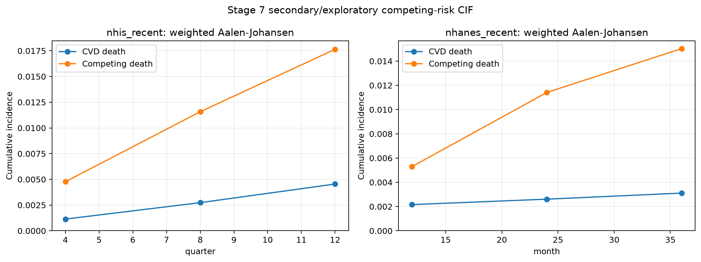
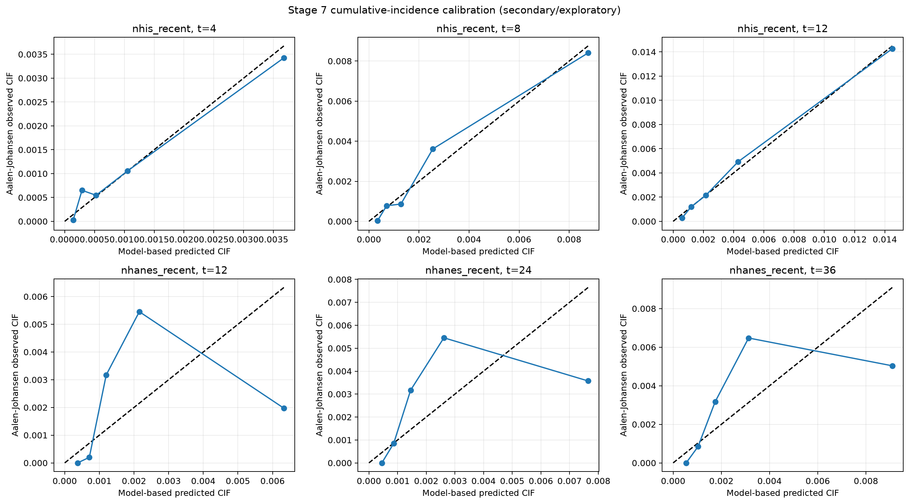

# Stage 7 secondary censored/competing-risk analysis

## Mandatory interpretation

All results are **secondary/exploratory**. They do not replace the fixed five-year NHIS development model or the Stage 6 temporal/external validation. The immutable minimal pipeline was applied without refitting; preprocessing, sigmoid calibration, and the fixed cutoff were not changed. Stage 7 results were not used for post-hoc primary-model or threshold selection.

The recent cohorts are distinct censored cohorts. No participant lacking complete five-year follow-up is represented as an ordinary negative case in a primary binary table.

## Immutable bindings

- Pipeline SHA-256: `758d635310a43596655bd23a0ebcebc293a0f4bde4ab5d98f3852a84e023a010`.
- Original lock normalized-LF SHA-256: `983461d0eaf53592fc26b2615ad4f00a6e2768482d1adac6366f49526ea1f6a3`.
- Lock amendment normalized-LF SHA-256: `84a846207cf221dbe9839ede497503f708b4738f1900c943ffe66e146b0ab450`.

## Recent-cohort counts and follow-up

| cohort        |     n |   censored |   cvd_deaths |   competing_deaths |   weight_sum |   followup_min |   followup_q25 |   followup_median |   followup_q75 |   followup_max | followup_time_unit   | followup_time_source             | role                                   |
|:--------------|------:|-----------:|-------------:|-------------------:|-------------:|---------------:|---------------:|------------------:|---------------:|---------------:|:---------------------|:---------------------------------|:---------------------------------------|
| nhis_recent   | 62249 |      60488 |          370 |               1391 |  1.25037e+08 |              1 |              9 |                13 |             17 |             20 | quarter              | NHIS_INTERVIEW_AND_DEATH_QUARTER | secondary_censored_competing_risk_only |
| nhanes_recent |  5865 |       5704 |           25 |                136 |  1.2351e+08  |              2 |             24 |                35 |             48 |             61 | month                | LMF_PERMTH_INT                   | secondary_censored_competing_risk_only |

NHIS time is the observed quarter interval number from interview through death or the administrative end at 2019-Q4; `+1` gives positive time for a death in the interview quarter and does not imply monthly precision. NHANES uses public LMF `PERMTH_INT` in months. NHIS and NHANES were never pooled into one survival model.

## Weighted Aalen-Johansen cumulative incidence

| cohort        |   horizon | time_unit   |    cif_cvd |   cif_competing |   survival |   raw_at_risk |   weighted_at_risk_proportion |
|:--------------|----------:|:------------|-----------:|----------------:|-----------:|--------------:|------------------------------:|
| nhis_recent   |         4 | quarter     | 0.00114017 |      0.00476832 |   0.994092 |         61961 |                      0.995821 |
| nhis_recent   |         8 | quarter     | 0.00273584 |      0.0115744  |   0.98569  |         51550 |                      0.800661 |
| nhis_recent   |        12 | quarter     | 0.00454553 |      0.017648   |   0.977807 |         37450 |                      0.547877 |
| nhanes_recent |        12 | month       | 0.00216175 |      0.00529308 |   0.992545 |          5817 |                      0.993123 |
| nhanes_recent |        24 | month       | 0.00260971 |      0.011411   |   0.985979 |          4465 |                      0.753431 |
| nhanes_recent |        36 | month       | 0.00311112 |      0.0150349  |   0.981854 |          2929 |                      0.506215 |

Competing death is retained as event type 2 in Aalen-Johansen estimation and is never treated as independent censoring for the CVD cumulative incidence.

## Time-dependent model metrics

| cohort        |   horizon | time_unit   |   time_dependent_auc |   ipcw_brier |   metric_known_n |   ipcw_weight_sum |   censoring_survival_before_horizon |   mean_model_based_cif |   observed_aalen_johansen_cif |   observed_expected_ratio | support_status             | interpretation        | evaluation_role                         |
|:--------------|----------:|:------------|---------------------:|-------------:|-----------------:|------------------:|------------------------------------:|-----------------------:|------------------------------:|--------------------------:|:---------------------------|:----------------------|:----------------------------------------|
| nhis_recent   |         4 | quarter     |             0.780333 |   0.00113805 |            62249 |       1.25037e+08 |                            1        |             0.00113657 |                    0.00114017 |                  1.00317  | PRIMARY_RECENT_EXPLORATORY | secondary_exploratory | apparent_secondary_cause_specific_model |
| nhis_recent   |         8 | quarter     |             0.809031 |   0.00272125 |            52377 |       1.24979e+08 |                            0.811045 |             0.00272735 |                    0.00273584 |                  1.00311  | PASS                       | secondary_exploratory | apparent_secondary_cause_specific_model |
| nhis_recent   |        12 | quarter     |             0.803451 |   0.00449552 |            38736 |       1.24881e+08 |                            0.560039 |             0.00454705 |                    0.00454553 |                  0.999666 | PASS                       | secondary_exploratory | apparent_secondary_cause_specific_model |
| nhanes_recent |        12 | month       |             0.682243 |   0.00216045 |             5865 |       1.2351e+08  |                            1        |             0.00215279 |                    0.00216175 |                  1.00417  | PRIMARY_RECENT_EXPLORATORY | secondary_exploratory | apparent_secondary_cause_specific_model |
| nhanes_recent |        24 | month       |             0.698375 |   0.00260267 |             4568 |       1.23489e+08 |                            0.764092 |             0.00260748 |                    0.00260971 |                  1.00086  | FAIL_INSUFFICIENT_SUPPORT  | secondary_exploratory | apparent_secondary_cause_specific_model |
| nhanes_recent |        36 | month       |             0.706376 |   0.00310018 |             3061 |       1.23473e+08 |                            0.515323 |             0.00310959 |                    0.00311112 |                  1.00049  | FAIL_INSUFFICIENT_SUPPORT  | secondary_exploratory | apparent_secondary_cause_specific_model |

AUC and Brier use survey weights and reverse-Kaplan-Meier IPCW for administrative censoring. Model-based CIF predictions are reconstructed jointly from weighted cause-specific CVD and non-CVD hazards with the frozen sigmoid linear predictor as the only model covariate. NHIS cause-specific Cox results are sensitivity analyses because quarter-discrete Aalen-Johansen is the primary NHIS secondary method.
The cause-specific baseline hazards and score coefficients are estimated and evaluated in the same recent cohort. Consequently Brier, O/E, and calibration-bin results are apparent secondary-model diagnostics, not independent validation of a new horizon-specific model; near-unity overall O/E is partly fitted by construction.

## Support rules

| cohort        |   horizon | time_unit   |   raw_cvd_events_by_horizon |   minimum_cvd_events | passes_event_rule   |   weighted_at_risk_proportion |   minimum_weighted_at_risk_proportion | passes_at_risk_rule   | longer_horizon_support_rule_applies   | model_performance_claim_allowed   | status                     |
|:--------------|----------:|:------------|----------------------------:|---------------------:|:--------------------|------------------------------:|--------------------------------------:|:----------------------|:--------------------------------------|:----------------------------------|:---------------------------|
| nhis_recent   |         4 | quarter     |                          81 |                  100 | False               |                      0.995821 |                                   0.2 | True                  | False                                 | False                             | PRIMARY_RECENT_EXPLORATORY |
| nhis_recent   |         8 | quarter     |                         183 |                  100 | True                |                      0.800661 |                                   0.2 | True                  | True                                  | True                              | PASS                       |
| nhis_recent   |        12 | quarter     |                         283 |                  100 | True                |                      0.547877 |                                   0.2 | True                  | True                                  | True                              | PASS                       |
| nhanes_recent |        12 | month       |                          10 |                  100 | False               |                      0.993123 |                                   0.2 | True                  | False                                 | False                             | PRIMARY_RECENT_EXPLORATORY |
| nhanes_recent |        24 | month       |                          16 |                  100 | False               |                      0.753431 |                                   0.2 | True                  | True                                  | False                             | FAIL_INSUFFICIENT_SUPPORT  |
| nhanes_recent |        36 | month       |                          20 |                  100 | False               |                      0.506215 |                                   0.2 | True                  | True                                  | False                             | FAIL_INSUFFICIENT_SUPPORT  |

At longer horizons, a model-performance claim requires at least 100 observed CVD deaths by the horizon and a weighted at-risk proportion of at least 0.20. Failed rows remain descriptive with CIF and at-risk counts only.

## Cumulative-incidence calibration

Calibration uses 5 survey-weighted equal-weight bins separately within each cohort and horizon. Boundaries are based on the model-based CIF for that horizon; observed values are weighted Aalen-Johansen CIF estimates.

## Limitations

- Follow-up is short and administratively limited at 31 December 2019.
- NHIS has quarter-level interval precision, not exact monthly or daily time.
- Public-use linked mortality files can contain synthetic follow-up time or cause   values for selected records, although vital status is not perturbed.
- Cause-specific Cox standard errors are model-based and not survey-cluster robust;   they are reported only as secondary sensitivity diagnostics.
- These U.S. population results do not establish clinical validity in Kazakhstan.
